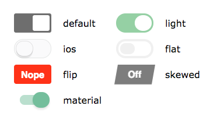
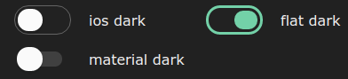

# ember-toggle

Checkbox based Toggle Switch component with swipe/drag support for Ember.

[![NPM][npm-badge]][npm-badge-url]

[![Ember Observer Score][ember-observer-badge]][ember-observer-url]

Based on [this](http://codepen.io/mallendeo/pen/eLIiG/) codepen.
Here's the official [demo] using this component.

## Compatibility

- Ember.js v3.24 or above
- Ember CLI v3.24 or above
- Node.js v12 or above

## Install

`ember install ember-toggle`

## Basic Usage

```hbs
<XToggle @value={{this.myValue}} @onToggle={{fn (mut this.myValue)}} />
```

### Themes



There are many `themes` which change the visual appearance of the toggle.
Check the [demo] for interactive examples.

- `'default'`
- `'ios'`
- `'light'`
- `'flat'`
- `'flip'`
- `'skewed'`
- `'material'`



Use it along with the `@variant='auto'` or `@variant='dark'` option to get a dark themed version, works only with 'ios', 'flat' and 'material' theme.

> Example of changing the theme

```hbs
<XToggle
  @theme='ios'
  @variant='dark'
  @value={{this.toggled}}
  @onToggle={{fn (mut this.toggled)}}
/>
```

_Note: you choose which themes ship with your app by importing their CSS files, see the Styling section below._

### Size

You can also adjust the size of the widget by use of the `size` property. Valid sizes are:

- `'small'`
- `'medium'`
- `'large'`

This option is available on all themes but is a less sensible choice for those themes which actually
include the label within the control (e.g., `skew` and `flip`).

### Labels

You can customize labels (The text the user sees for the two states) and their associated values:

```hbs
<XToggle
  @onLabel='Enabled'
  @offLabel='Disabled'
  @showLabels={{true}}
  @value={{this.myValue}}
  @onToggle={{fn (mut this.myValue)}}
/>
```

If you want your labels to be displayed, then you must set `showLabels` to `true`.

### Available Options

- `value` - The state of the switch, can be `true` or `false`. Defaults to `false`.
- `onToggle` - The action that should change the state of `value`.
- `theme` - One of 'light', 'ios', 'flat', 'material', 'flip', 'skewed', 'default'.
- `variant` - One of `dark` or `auto`. Use `auto` for system dependent light/dark theme. Works only with `ios`, `flat` and `material` theme.
  Defaults to 'default' if not specified.
- `size` - One of 'small', 'medium', 'large'.
  Defaults to 'medium' if not specified.
- `onLabel` - The label for the _on_ state. Defaults to 'On'.
- `offLabel` - The label for the _off_ state. Defaults to 'Off'.
- `showLabels` - Defaults to 'false', if 'true' will display labels on left and ride side of toggle switch
- `disabled` - Defaults to `false`, which means you can click the toggle.
  When `true`, an `.x-toggle-disabled` class is set on the toggle and an `.x-toggle-container-disabled` class is set on the component.
- `name` - A name to differentiate multiple toggles, gets passed to the `toggle` action. Defaults to 'default'.

### Styling

Since `ember-toggle` is a v2 addon, it can no longer inject its CSS into your
app's build automatically. Import the base styles plus whichever themes you
use, e.g. in your app's `app.js`:

```js
import 'ember-toggle/styles/base.css';
import 'ember-toggle/styles/themes/default.css';
import 'ember-toggle/styles/themes/light.css';
```

Available theme files, under `ember-toggle/styles/themes/`:
`default.css`, `light.css`, `ios.css`, `flat.css`, `skewed.css`, `flip.css`,
`material.css`.

> note: the IOS theme is referred to as just `ios` not `ios7` as was indicated in the originating CSS source

Only import the themes you actually use, to keep your app's CSS bundle small.
If you want to write your own theme entirely, skip importing any theme file
and use `ember-toggle/styles/themes/default.css` as a reference for the class
names each component renders.

### Configuring

You can set app-wide defaults for non-theme options. These defaults can be
overriden on a per toggle basis.

This configuration is located in `config/environment.js`.  
The following is an example of how you can configure this addon:

```js
ENV['ember-toggle'] = {
  defaultShowLabels: true, // defaults to false
  defaultTheme: 'light', // defaults to 'default'
  defaultSize: 'small', // defaults to 'medium'
  defaultOffLabel: 'False', // defaults to 'Off'
  defaultOnLabel: 'True', // defaults to 'On'
};
```

## Advanced Usage

If you need custom labels, additional markup, or non-standard behavior, you are in the right section.

The `x-toggle` component also provides a composable component API.

```hbs
<XToggle
  @showLabels={{true}}
  @value={{this.value}}
  @onToggle={{fn (mut this.value)}}
  as |toggle|
>
  <toggle.offLabel />
  <toggle.switch />
  <toggle.onLabel />
</XToggle>
```

The above is a simple example that returns a basic toggle, but you can see how
this could be used to wrap the switch or the labels in custom markup or logic.

### Single Label

This format allows greater flexibility with labels, like the single label use-case.

```hbs
<XToggle
  @showLabels={{true}}
  @value={{this.value}}
  @onToggle={{fn (mut this.value)}}
  as |toggle|
>
  <toggle.label @value={{not this.value}}>
    <b>turn {{if this.value 'off' 'on'}}</b>
  </toggle.label>

  <toggle.switch @theme='flip' @onLabel='diff on' @offLabel='diff off' />
</XToggle>
```

> Note: The `not` helper is a custom Ember helper in the above example.

## Contributing

See the [Contributing] guide for details.

## License

MIT

[npm-badge]: https://img.shields.io/npm/v/ember-toggle.svg
[npm-badge-url]: https://www.npmjs.com/package/ember-toggle
[ember-observer-badge]: http://emberobserver.com/badges/ember-toggle.svg
[ember-observer-url]: http://emberobserver.com/addons/ember-toggle
[demo]: http://knownasilya.github.io/ember-toggle/
[contributing]: CONTRIBUTING.md
[simplify]: https://github.com/knownasilya/ember-toggle/tree/simplify
